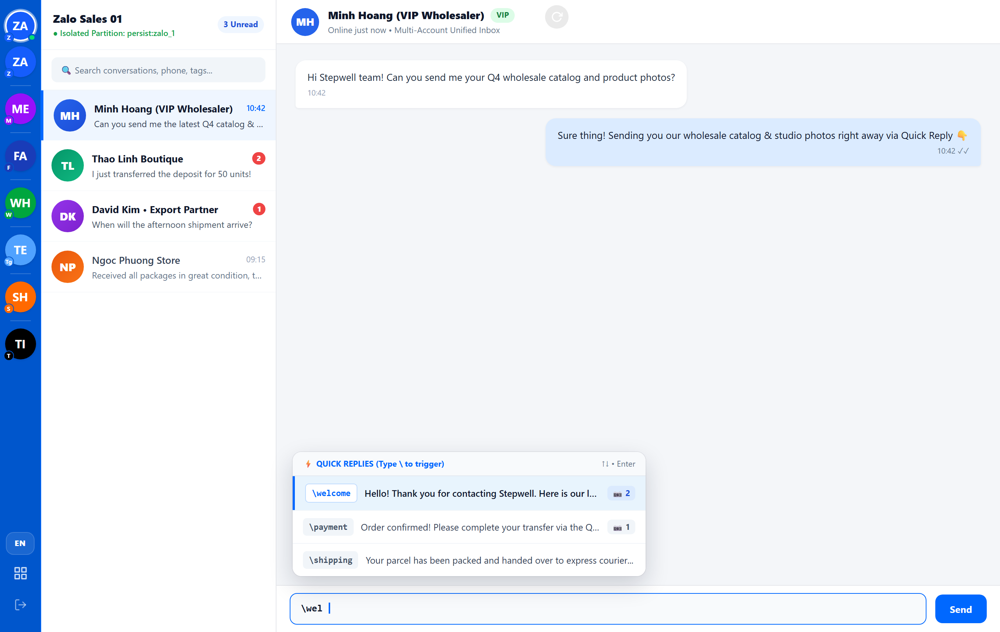
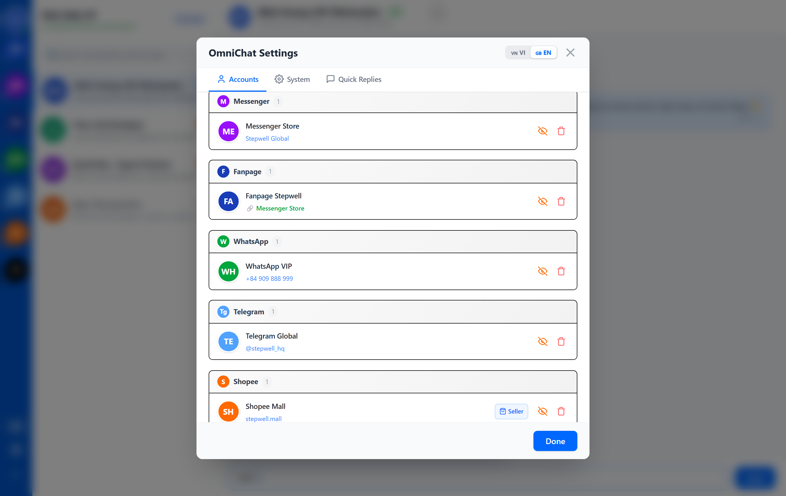
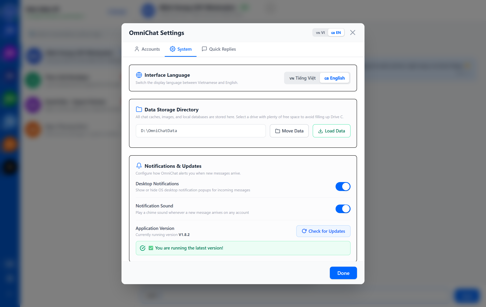
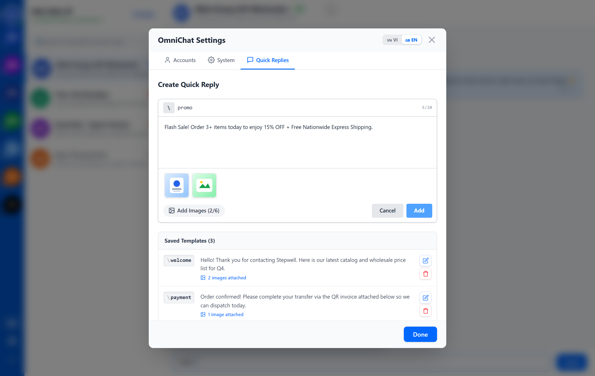
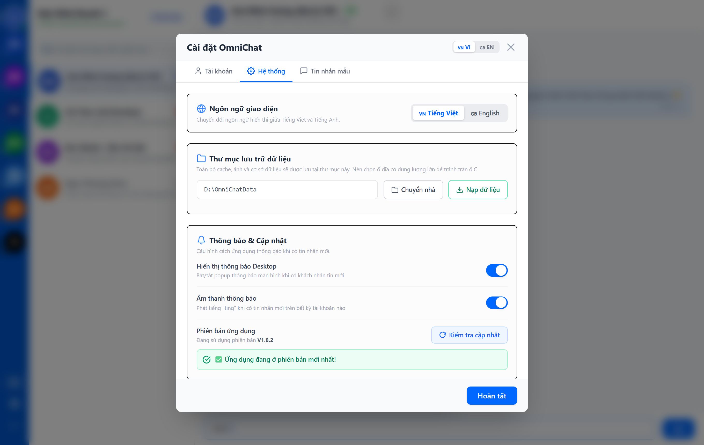
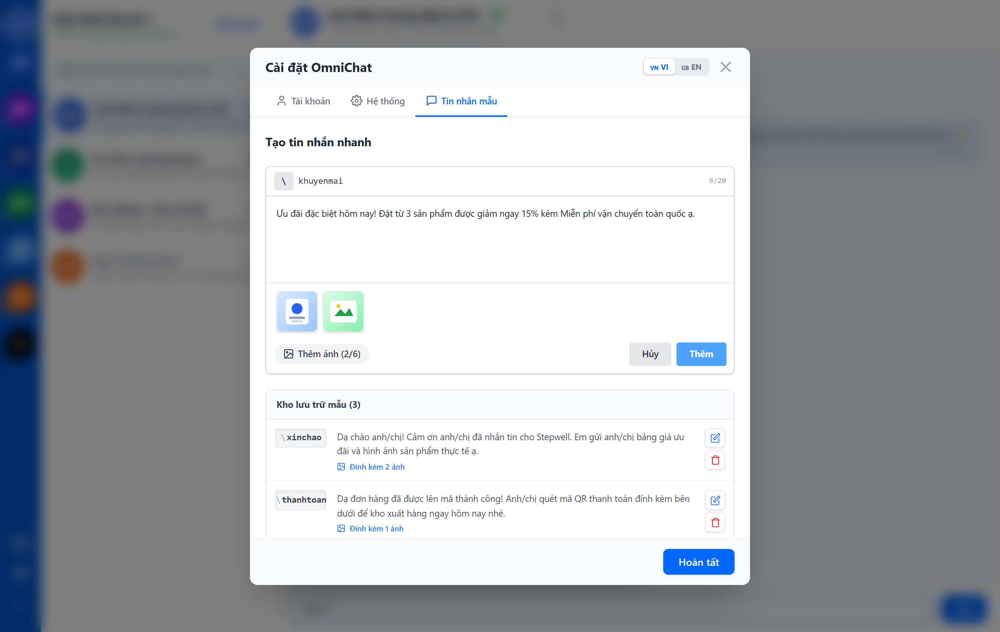

<div align="center">


# 🚀 OmniChat v1.8.2

### **All-in-One Multi-Platform Messaging Desktop Workspace**
*Ứng Dụng Desktop Hợp Nhất Đa Tài Khoản Nhắn Tin & Sàn TMĐT (English & Tiếng Việt)*

[](https://github.com/duongbirken2510/OmniChat/releases/tag/v1.8.2)
[-78.9%20MB%20.exe-0078D6?style=for-the-badge&logo=windows)](https://github.com/duongbirken2510/OmniChat/releases/download/v1.8.2/OmniChat_V1.8.2_Setup.exe)
[](https://electronjs.org/)
[](#)
[](https://duongbirken.deta.vn)

[**🇬🇧 English**](#-english) • [**📸 Screenshots (EN)**](#-ui-screenshots-english-edition) • [**📥 Download `.exe`**](#-download-official-installer-latest-v182) • [**🇻🇳 Tiếng Việt**](#-tiếng-việt) • [**📸 Ảnh Giao Diện (VI)**](#-ảnh-chụp-giao-diện-bản-tiếng-việt) • [**👨‍💻 Author & Contact**](#-author--contact--tác-giả--liên-hệ)

</div>

---

## 🇬🇧 English

<div align="center">
  
</div>

<br />

**OmniChat** is a lightweight, high-performance desktop workspace built with **Electron**, **Vue 3**, and **TypeScript**. Designed for sales, telesales, e-commerce sellers, and customer support teams, OmniChat unifies multiple accounts across **7 messaging & marketplace platforms** into a single window with strict session isolation and instant quick-reply tools.

### 📥 Download Official Installer (Latest: `v1.8.2`)

| Operating System | Architecture | Installer Package | Size | Direct Download |
| :--- | :---: | :--- | :---: | :---: |
| **Windows 10 / 11** | `x64` (64-bit) | `OmniChat_V1.8.2_Setup.exe` | **78.9 MB** | [**⬇️ Download `.exe`**](https://github.com/duongbirken2510/OmniChat/releases/download/v1.8.2/OmniChat_V1.8.2_Setup.exe) |
| **All Releases** | — | GitHub Releases Page | — | [View Release Notes](https://github.com/duongbirken2510/OmniChat/releases/latest) |

### 🌐 Supported Platforms

| Platform | Multi-Account | Special Capabilities |
| :--- | :---: | :--- |
| **Zalo** | ✅ | Real-time unread badge scanning, auto profile/avatar sync, external link routing |
| **Facebook Messenger** | ✅ | Isolated sessions + 1-click toggle to Facebook feed |
| **Facebook Fanpage** | ✅ | Meta Business Suite Inbox — supports **shared-cookie linking** with Messenger accounts (no re-login) or standalone partitions |
| **WhatsApp** | ✅ | Full WhatsApp Web multi-account support |
| **Telegram** | ✅ | Integrated Telegram Web K (`web.telegram.org/k/`) |
| **Shopee** | ✅ | Shopee Seller Webchat + 1-click **Seller Center** switch sharing the same session |
| **TikTok Shop** | ✅ | TikTok Seller Chat + 1-click **Seller Center** switch & custom-protocol popup blocker (`bytedance://`) |

### 📸 UI Screenshots (English Edition)

#### 1. Unified Multi-Platform Workspace & `\` Quick Reply Autocomplete
Operate accounts across Zalo, Messenger, Fanpage, WhatsApp, Telegram, Shopee, and TikTok side-by-side. Type `\shortcut` in any chat box to trigger the live Quick Reply popup with attached image counts.



#### 2. Multi-Account Manager & Shared-Cookie Fanpage Linking
Group accounts cleanly by platform, customize aliases/avatars, hide inactive accounts to free RAM (`0 MB` webview overhead), or link Facebook Fanpages directly to an existing Messenger session.



#### 3. System Settings: 1-Click Bilingual Switcher & Portable Storage
Switch between **English** and **Vietnamese** instantly, relocate `OmniChatData` off Drive C (`Move Data`), or connect to an existing portable profile (`Load Data`) from a USB drive or another PC.



#### 4. Smart Quick Replies with Multi-Image Auto-Paste
Create reusable `\shortcut` templates with up to **6 local images** — text is inserted first and images are pasted sequentially via the native OS clipboard.



### ✨ Key Features

1. **Strict Multi-Account Session Isolation (`persist:` Partitions):** Run multiple accounts of the same platform simultaneously without cookie collisions. Inactive tabs pause DOM/avatar polling, and hidden accounts completely unmount webviews.
2. **Smart Quick Replies (`\` Trigger + 6 Images):** Instant inline autocomplete across all webviews with automatic native-clipboard image pasting.
3. **Real-Time Notifications & Sound Chime:** Intercepts web notifications immediately to display native desktop popups, play a Web Audio API chime, and bounce an unread bell indicator.
4. **Zero Drive-C Bloat & Portable Profiles:** Relocate storage to `D:\OmniChatData` or load existing sessions from external drives backed by automatic JSON snapshots.
5. **Bilingual Interface (`🇬🇧 EN` / `🇻🇳 VI`):** Live 1-click language switching across the sidebar, settings modal, and native OS dialogs.

### 🛠️ Tech Stack

* **Desktop Runtime:** Electron 33 (`webviewTag` + isolated session partitions + custom `local-img://` protocol)
* **Frontend:** Vue 3 (`<script setup>` Composition API), TypeScript, Vite (`electron-vite`), Tailwind CSS 4
* **Local Database:** Dexie.js (IndexedDB) + automatic local JSON file backups
* **Packaging:** `electron-builder` (Maximum-compressed NSIS installer for Windows, DMG for macOS, AppImage/DEB/Snap for Linux)

### 🚀 Getting Started (For Developers)

```bash
# 1. Clone repository & install dependencies
git clone https://github.com/duongbirken2510/OmniChat.git
cd OmniChat
pnpm install

# 2. Start hot-reload development environment
pnpm run dev

# 3. Typecheck & build production installers
pnpm run typecheck
pnpm run build:win     # Windows (.exe)
pnpm run build:mac     # macOS (.dmg)
pnpm run build:unpack  # Unpacked folder for local testing
```

---

## 🇻🇳 Tiếng Việt

**OmniChat** là ứng dụng Desktop đa nền tảng gọn nhẹ, hiệu năng cao được xây dựng trên **Electron**, **Vue 3** và **TypeScript**. Được thiết kế chuyên biệt cho đội ngũ Kinh doanh, Telesale, Nhà bán hàng TMĐT và Chăm sóc Khách hàng (CSKH), OmniChat giúp vận hành đồng thời nhiều tài khoản trên **7 nền tảng nhắn tin & sàn thương mại điện tử** ngay trong một cửa sổ duy nhất.

### 📥 Tải Bộ Cài Đặt Chính Thức (Mới nhất: `v1.8.2`)

| Hệ điều hành | Kiến trúc | Tên tệp cài đặt | Dung lượng | Liên kết tải trực tiếp |
| :--- | :---: | :--- | :---: | :---: |
| **Windows 10 / 11** | `x64` (64-bit) | `OmniChat_V1.8.2_Setup.exe` | **78.9 MB** | [**⬇️ Tải bộ cài `.exe`**](https://github.com/duongbirken2510/OmniChat/releases/download/v1.8.2/OmniChat_V1.8.2_Setup.exe) |
| **Tất cả phiên bản** | — | Trang GitHub Releases | — | [Xem chi tiết bản phát hành](https://github.com/duongbirken2510/OmniChat/releases/latest) |

### 🌐 Các Nền Tảng Hỗ Trợ

| Nền tảng | Đa tài khoản | Tính năng chuyên biệt |
| :--- | :---: | :--- |
| **Zalo** | ✅ | Tự động đồng bộ tên/ảnh đại diện, quét số tin chưa đọc thời gian thực, mở link ngoài mượt mà |
| **Facebook Messenger** | ✅ | Cách ly phiên đăng nhập độc lập + nút chuyển nhanh sang Facebook |
| **Facebook Fanpage** | ✅ | Meta Business Suite Inbox — hỗ trợ **liên kết chung cookie** với tài khoản Messenger (không cần đăng nhập lại) hoặc tạo độc lập |
| **WhatsApp** | ✅ | Hỗ trợ đăng nhập song song nhiều tài khoản WhatsApp Web |
| **Telegram** | ✅ | Tích hợp sẵn Telegram Web K (`web.telegram.org/k/`) |
| **Shopee** | ✅ | Shopee Webchat + chuyển nhanh sang **Kênh Người Bán** giữ nguyên phiên đăng nhập |
| **TikTok Shop** | ✅ | TikTok Seller Chat + mở nhanh **Kênh Người Bán** & chặn triệt để popup protocol lạ (`bytedance://`) |

### 📸 Ảnh Chụp Giao Diện (Bản Tiếng Việt)

#### 1. Không Gian Hộp Thư Hợp Nhất & Gợi Ý Tin Nhắn Nhanh `\`
Quản lý song song Zalo, Messenger, Fanpage, WhatsApp, Telegram, Shopee và TikTok trên thanh Sidebar trực quan. Gõ `\phimtat` ngay tại ô nhập chat để bật menu chèn mẫu kèm hình ảnh đính kèm.


#### 2. Quản Lý Đa Tài Khoản & Liên Kết Fanpage Chung Cookie
Phân nhóm tài khoản rõ ràng theo từng nền tảng, đổi tên gọi nhớ/ảnh đại diện, bấm **Ẩn** để giải phóng hoàn toàn RAM webview, hoặc liên kết Fanpage dùng chung phiên đăng nhập với Messenger.


#### 3. Cài Đặt Hệ Thống: Song Ngữ 1-Chạm & Chuyển Nhà Dữ Liệu
Chuyển đổi tức thì giữa **Tiếng Việt (`🇻🇳 VI`)** và **Tiếng Anh (`🇬🇧 EN`)**, di chuyển thư mục `OmniChatData` sang ổ đĩa khác tránh tràn ổ C (**Chuyển nhà**) hoặc kết nối hồ sơ có sẵn từ USB/máy khác (**Nạp dữ liệu**).



#### 4. Kho Tin Nhắn Mẫu Kèm Tự Động Dán 6 Hình Ảnh
Tạo nhanh phím tắt `\khuyenmai`, `\xinchao`, `\thanhtoan` đính kèm tối đa **6 ảnh sản phẩm / mã QR** — ứng dụng tự động điền chữ trước rồi dán lần lượt từng ảnh qua Clipboard hệ thống.



### ✨ Tính Năng Nổi Bật

1. **Cách Ly Phiên Đăng Nhập & Tiết Kiệm Tài Nguyên:** Mỗi tài khoản chạy trong một phân vùng Chromium `persist:` độc lập; tự động tạm dừng quét DOM trên tab ẩn và tắt hẳn webview khi ẩn tài khoản.
2. **Tin Nhắn Mẫu Siêu Tốc (`\` + 6 Ảnh):** Gợi ý trực tiếp trong mọi ô nhập liệu và tự động dán ảnh qua Clipboard hệ điều hành.
3. **Thông Báo & Âm Thanh Tức Thì:** Bắt thông báo thời gian thực kèm âm báo Web Audio API, popup thông báo Desktop và hiệu ứng chuông rung trên Sidebar.
4. **Chuyển Nhà & Nạp Hồ Sơ Di Động:** Chống tràn ổ C hiệu quả, kết hợp cơ chế tự động sao lưu JSON bảo vệ danh sách tài khoản và tin nhắn mẫu khi cài mới/cập nhật.
5. **Giao Diện Song Ngữ Anh – Việt (`🇬🇧 EN` / `🇻🇳 VI`):** Đổi ngôn ngữ 1-chạm trên Sidebar hoặc trong Cài đặt, đồng bộ cả hộp thoại gốc của hệ điều hành.

### 🛠️ Công Nghệ Nền Tảng

* **Desktop Runtime:** Electron 33 (`webviewTag` + phân vùng phiên độc lập + giao thức nội bộ `local-img://`)
* **Frontend:** Vue 3 (`<script setup>` Composition API), TypeScript, Vite (`electron-vite`), Tailwind CSS 4
* **Cơ sở dữ liệu cục bộ:** Dexie.js (IndexedDB) kết hợp tự động sao lưu file JSON trên ổ cứng
* **Đóng gói:** `electron-builder` (Nén tối đa NSIS cho Windows, DMG cho macOS, AppImage/DEB/Snap cho Linux)

### 🚀 Hướng Dẫn Cài Đặt & Phát Triển

```bash
# 1. Clone mã nguồn & cài đặt thư viện
git clone https://github.com/duongbirken2510/OmniChat.git
cd OmniChat
pnpm install

# 2. Khởi chạy môi trường phát triển (Hot-Reload)
pnpm run dev

# 3. Kiểm tra kiểu dữ liệu & đóng gói bộ cài đặt
pnpm run typecheck
pnpm run build:win     # Đóng gói bộ cài Windows (.exe)
pnpm run build:mac     # Đóng gói bộ cài macOS (.dmg)
pnpm run build:unpack  # Biên dịch thư mục chạy thử
```

---

## 👨‍💻 Author & Contact / Tác Giả & Liên Hệ

| 🇬🇧 About the Author | 🇻🇳 Thông Tin Tác Giả |
| :--- | :--- |
| **OmniChat** is engineered and maintained by **Duong Birken** to streamline multi-account customer communication across messaging apps and e-commerce marketplaces.<br><br>🌐 **Website:** [https://duongbirken.deta.vn](https://duongbirken.deta.vn)<br>🐞 **Issues & Feedback:** [GitHub Issues](https://github.com/duongbirken2510/OmniChat/issues) | **OmniChat** được phát triển và tối ưu bởi **Duong Birken** nhằm giải quyết triệt để bài toán vận hành đa tài khoản nhắn tin & chăm sóc khách hàng đa sàn trên một không gian hợp nhất.<br><br>🌐 **Website:** [https://duongbirken.deta.vn](https://duongbirken.deta.vn)<br>🐞 **Báo lỗi & Góp ý:** [GitHub Issues](https://github.com/duongbirken2510/OmniChat/issues) |
