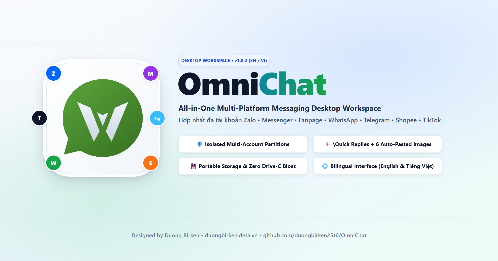
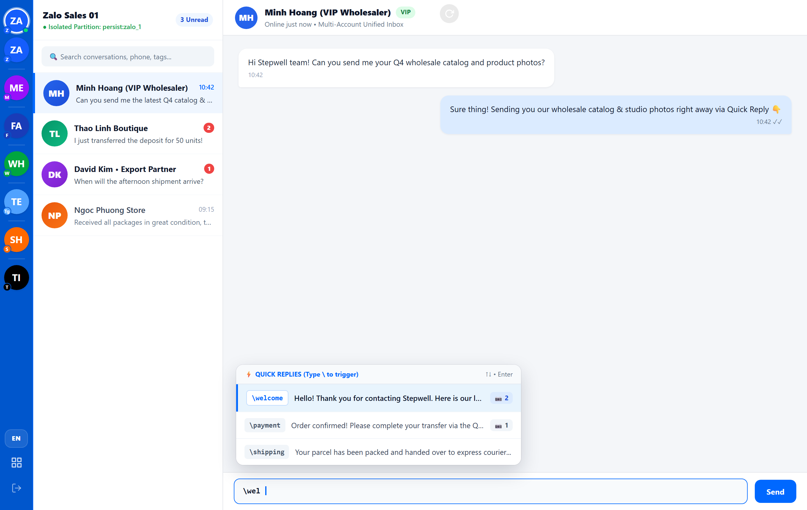
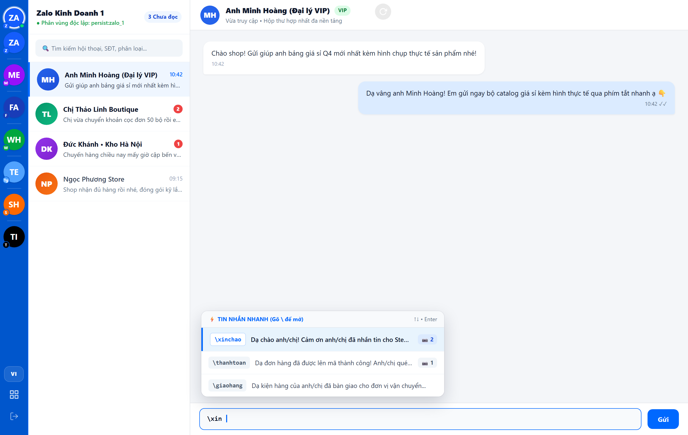

  

# 🚀 Stepwell OmniChat — v1.8.2 Release Notes

---

## 🇬🇧 English

### 📦 Direct Installer Download
- **Windows 10 / 11 (x64 — 78.9 MB):** [`OmniChat_V1.8.2_Setup.exe`](https://github.com/duongbirken2510/OmniChat/releases/download/v1.8.2/OmniChat_V1.8.2_Setup.exe)

### ✨ What's New in v1.8.2
- **Bilingual Interface (`🇬🇧 English` & `🇻🇳 Tiếng Việt`):** Instant 1-click language switching across the left sidebar, Settings modal, notifications, and native OS dialogs.
- **7 Unified Messaging & E-Commerce Platforms:** Zalo, Facebook Messenger, Facebook Fanpage (shared-cookie linking or standalone), WhatsApp, Telegram Web K, Shopee Seller Chat, and TikTok Shop Chat.
- **Quick Reply Snippets (`\shortcut`):** Inline autocomplete popup supporting text templates + up to **6 auto-pasted images** via native clipboard.
- **Smart Storage Migration & Portable Profile Loader:** Relocate `OmniChatData` off Drive C or mount existing profiles from external drives/PCs without re-logging in.
- **Optimized Windows Packaging (`78.9 MB`):** Maximum NSIS compression with custom 512px Stepwell OmniChat icon embedded cleanly into both the installer and `StepwellOmniChat.exe`.

---

## 🇻🇳 Tiếng Việt

### 📦 Tải Trực Tiếp Bộ Cài Đặt
- **Windows 10 / 11 (x64 — 78.9 MB):** [`OmniChat_V1.8.2_Setup.exe`](https://github.com/duongbirken2510/OmniChat/releases/download/v1.8.2/OmniChat_V1.8.2_Setup.exe)

### ✨ Điểm Mới Trong Phiên Bản v1.8.2
- **Giao diện Song Ngữ (`🇻🇳 Tiếng Việt` & `🇬🇧 English`):** Chuyển đổi ngôn ngữ tức thì chỉ với 1 cú nhấp chuột trên thanh Sidebar, cửa sổ Cài đặt, thông báo và hộp thoại hệ điều hành.
- **Hợp nhất 7 Nền Tảng Nhắn Tin & TMĐT:** Zalo, Facebook Messenger, Facebook Fanpage (liên kết chung cookie với Messenger hoặc độc lập), WhatsApp, Telegram Web K, Shopee Chat và TikTok Shop Chat.
- **Tin Nhắn Mẫu Siêu Tốc (`\phimtat`):** Gợi ý trực tiếp tại ô nhập chat, hỗ trợ đính kèm tối đa **6 hình ảnh** tự động dán qua Clipboard.
- **Chuyển Nhà & Nạp Dữ Liệu Di Động:** Di chuyển toàn bộ `OmniChatData` sang ổ đĩa khác tránh tràn ổ C hoặc nạp trực tiếp hồ sơ từ USB/máy tính khác.
- **Tối Ưu Bộ Cài Đặt Windows (`78.9 MB`):** Nén tối đa NSIS và nhúng chuẩn biểu tượng Stepwell OmniChat 512px vào cả trình cài đặt lẫn file thực thi `StepwellOmniChat.exe`.

---

| 👤 Author / Tác giả | 🔗 Links / Liên hệ |
| :--- | :--- |
| **Duong Birken** | 🌐 Website: [https://duongbirken.deta.vn](https://duongbirken.deta.vn) 💻 GitHub: [https://github.com/duongbirken2510/OmniChat](https://github.com/duongbirken2510/OmniChat) |
