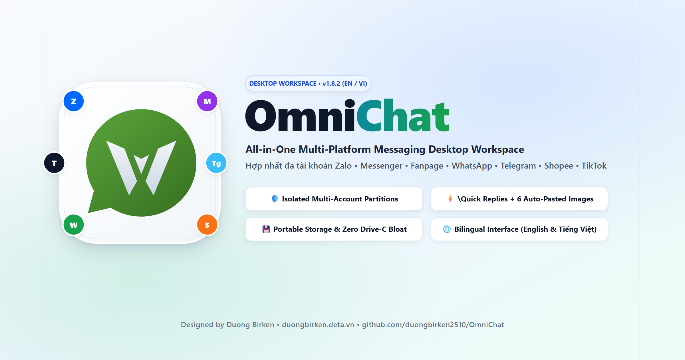
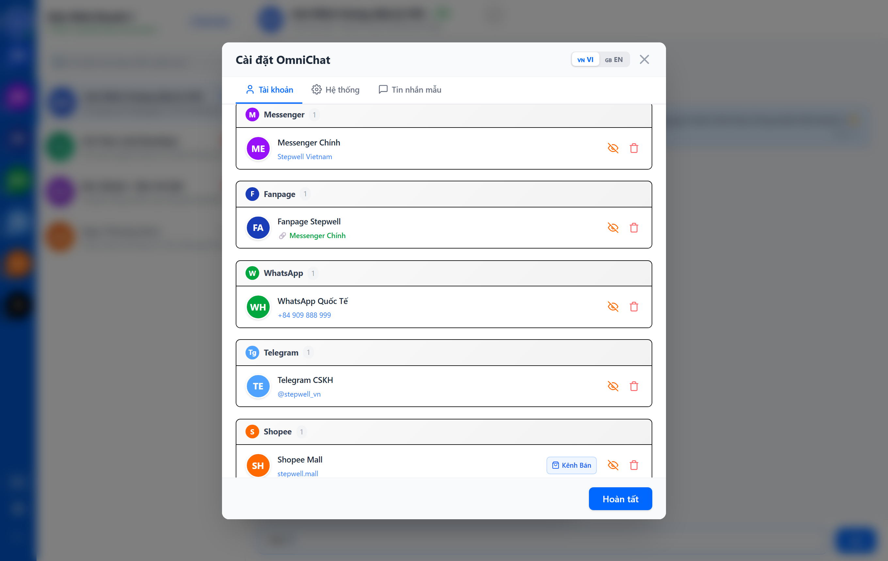
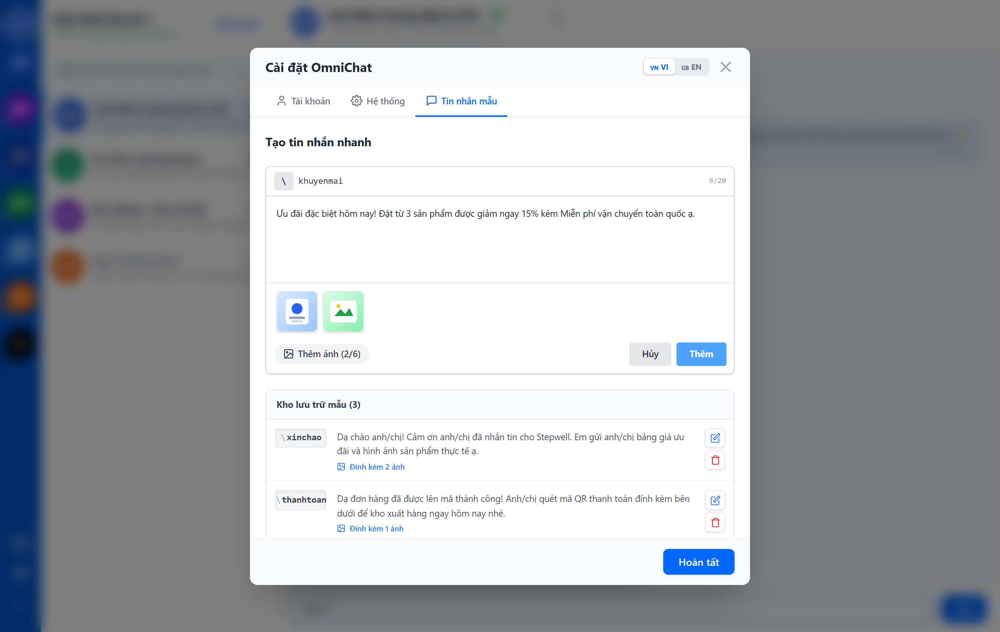
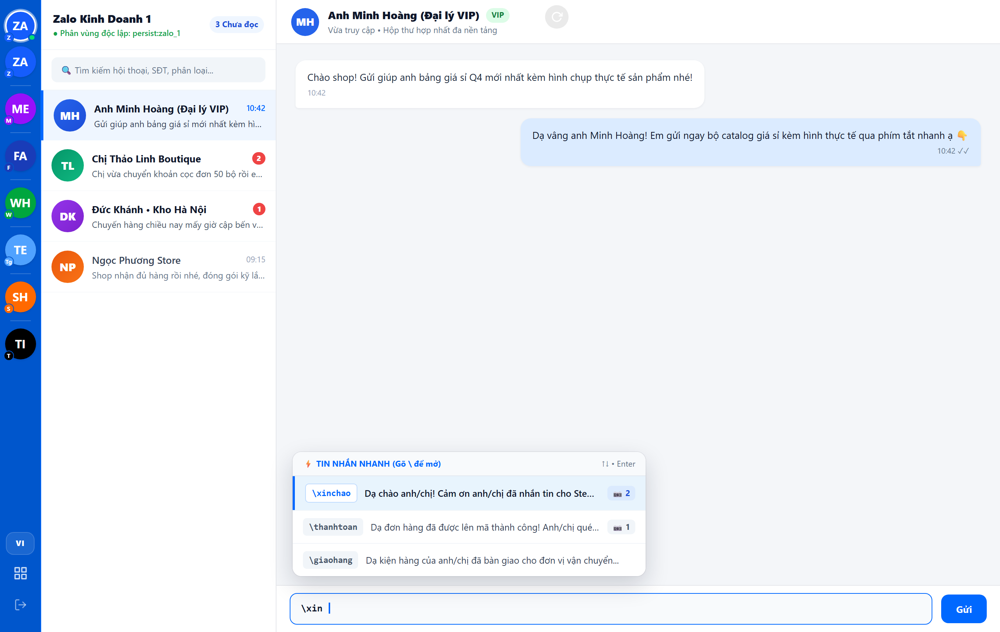
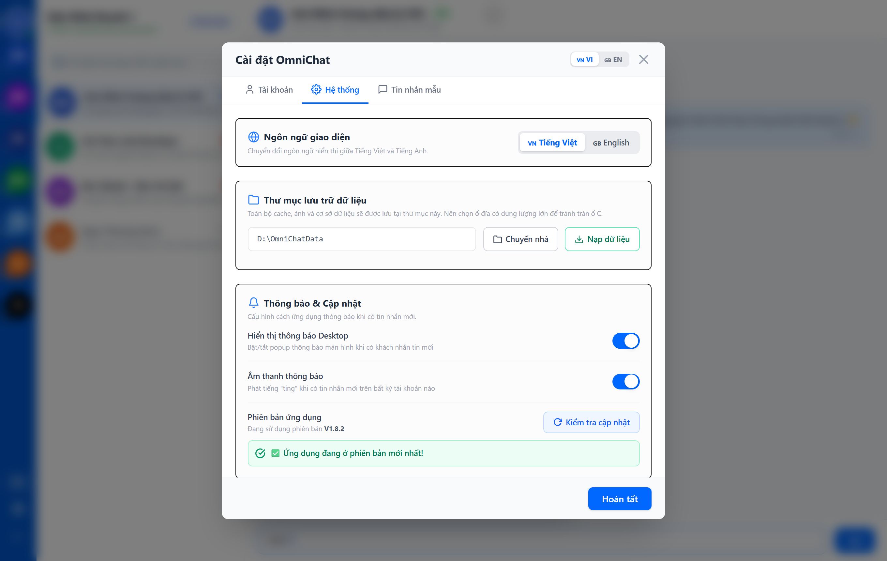
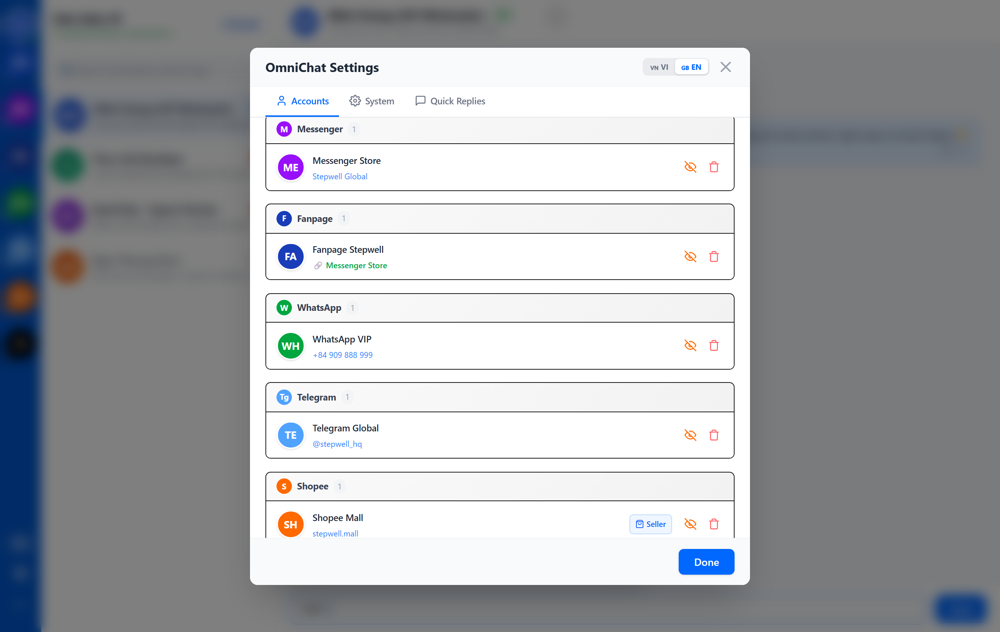
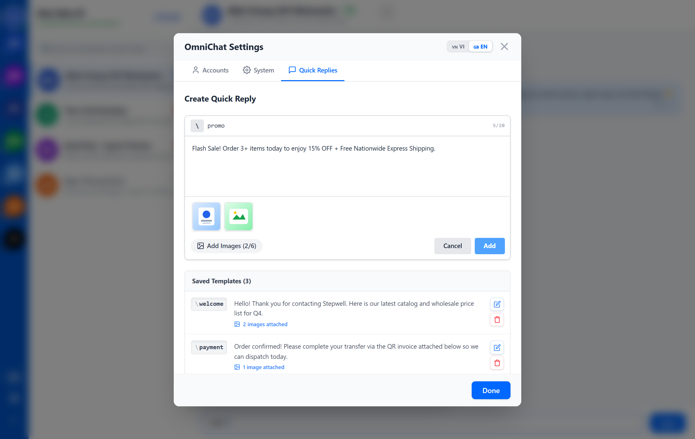
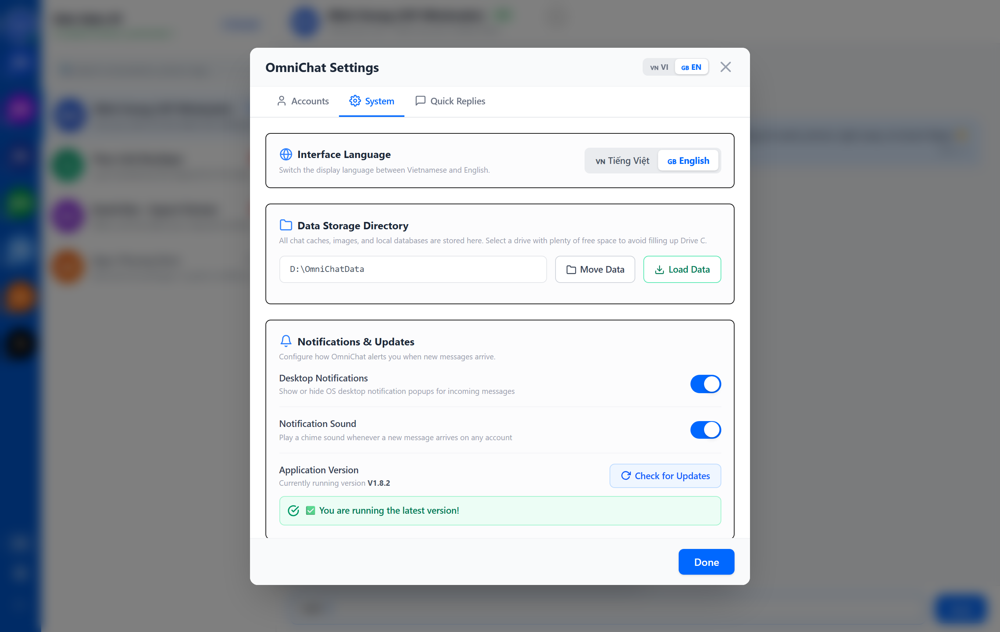

# 📖 CẨM NANG HƯỚNG DẪN SỬ DỤNG OMNICHAT TOÀN TẬP (A–Z)
## Stepwell OmniChat v1.8.2 — Bilingual User Guide (Tiếng Việt & English)

<div align="center">
  
</div>

> **Trang sản phẩm chính thức / Official Product Page:** [https://duongbirken.deta.vn/omnichat](https://duongbirken.deta.vn/omnichat)  
> **Tải bộ cài đặt / Download Installers:** [GitHub Releases v1.8.2](https://github.com/duongbirken2510/OmniChat/releases/tag/v1.8.2)

---

## 📑 Mục Lục Nhanh / Quick Navigation
- **Phần A — 🇻🇳 Hướng Dẫn Sử Dụng Tiếng Việt (Từ A đến Z)**
  1. [Bước 1: Tải & Cài đặt nhanh trên Windows, macOS và Linux](#1-bước-1-tải--cài-đặt-nhanh-trên-windows-macos-và-linux)
  2. [Bước 2: Thêm nhiều tài khoản Zalo, Messenger, Shopee, TikTok, WA, Tele](#2-bước-2-thêm-nhiều-tài-khoản-zalo-messenger-shopee-tiktok-wa-tele)
  3. [Bước 3: Liên kết Fanpage Facebook dùng chung đăng nhập với Messenger (Không cần 2FA)](#3-bước-3-liên-kết-fanpage-facebook-dùng-chung-đăng-nhập-với-messenger)
  4. [Bước 4: Tạo tin nhắn mẫu `\phimtat` & Tự động dán 6 ảnh sản phẩm trong 1 giây](#4-bước-4-tạo-tin-nhắn-mẫu-phimtat--tự-động-dán-6-ảnh-sản-phẩm-trong-1-giây)
  5. [Bước 5: "Chuyển nhà dữ liệu" sang ổ D hoặc USB — Vĩnh biệt nỗi lo đầy ổ C](#5-bước-5-chuyển-nhà-dữ-liệu-sang-ổ-d-hoặc-usb--vĩnh-biệt-nỗi-lo-đầy-ổ-c)
  6. [Bước 6: Mẹo tối ưu RAM (Nút Ẩn 0 MB RAM) & Chuyển nhanh Kênh Người Bán](#6-bước-6-mẹo-tối-ưu-ram-nút-ẩn-0-mb-ram--chuyển-nhanh-kênh-người-bán)
- **Part B — 🇬🇧 English User Guide (Step-by-Step)**
  1. [Step 1: Installation on Windows, macOS, and Linux](#step-1-installation-on-windows-macos-and-linux)
  2. [Step 2: Adding Multiple Accounts & Shared-Cookie Fanpage Linking](#step-2-adding-multiple-accounts--shared-cookie-fanpage-linking)
  3. [Step 3: Using `\shortcut` Quick Replies with 6-Image Auto-Paste](#step-3-using-shortcut-quick-replies-with-6-image-auto-paste)
  4. [Step 4: 1-Click Portable Data Relocation ("Move Data" & "Load Data")](#step-4-1-click-portable-data-relocation-move-data--load-data)

---

# 🇻🇳 PHẦN A — HƯỚNG DẪN SỬ DỤNG TIẾNG VIỆT (TỪ A ĐẾN Z)

## 1. Bước 1: Tải & Cài đặt nhanh trên Windows, macOS và Linux

### 💻 A. Trên máy tính Windows 10 / 11 (64-bit)
1. Tải bộ cài đặt chính thức: **[`OmniChat_V1.8.2_Setup.exe` (78.9 MB)](https://github.com/duongbirken2510/OmniChat/releases/download/v1.8.2/OmniChat_V1.8.2_Setup.exe)**.
2. Nhấp đúp vào file vừa tải về. Nếu Windows hiện bảng xanh *Windows protected your PC (SmartScreen)*:
   - Bấm vào dòng chữ **More info** (*Thông tin thêm*).
   - Bấm nút **Run anyway** (*Vẫn chạy*) — quá trình cài đặt sẽ hoàn tất sau 5 giây và tự tạo biểu tượng **Stepwell OmniChat** ngoài màn hình Desktop.

### 🍎 B. Trên máy MacBook / iMac (macOS)
1. Tải bộ cài đặt **[`OmniChat_V1.8.2.dmg`](https://github.com/duongbirken2510/OmniChat/releases/download/v1.8.2/OmniChat_V1.8.2.dmg)** (hoặc bản nén **[`OmniChat_V1.8.2_macOS.zip`](https://github.com/duongbirken2510/OmniChat/releases/download/v1.8.2/OmniChat_V1.8.2_macOS.zip)**).
2. Mở file `.dmg` và kéo biểu tượng **Stepwell OmniChat** vào thư mục **Applications**.
3. Nếu macOS báo ứng dụng chưa xác minh từ App Store, hãy mở ứng dụng **Terminal**, dán dòng lệnh sau và nhấn `Enter` (chỉ cần làm 1 lần duy nhất):
   ```bash
   xattr -cr "/Applications/Stepwell OmniChat.app"
   ```

### 🐧 C. Trên máy tính Linux (Ubuntu / Debian / Mint / Fedora)
- **Cách 1 — Cài bằng gói `.deb` (Ubuntu/Debian/Mint):**
  ```bash
  sudo dpkg -i OmniChat_V1.8.2_amd64.deb
  ```
- **Cách 2 — Chạy trực tiếp file `.AppImage` không cần cài đặt:**
  ```bash
  chmod +x OmniChat_V1.8.2.AppImage
  ./OmniChat_V1.8.2.AppImage
  ```

---

## 2. Bước 2: Thêm nhiều tài khoản Zalo, Messenger, Shopee, TikTok, WA, Tele



1. Nhìn xuống góc dưới cùng bên trái của thanh **Sidebar màu xanh**, bấm vào biểu tượng **Quản lý hệ thống (4 ô vuông ⊞)** ➔ chọn tab **Quản lý Tài khoản**.
2. Chọn nền tảng bạn muốn thêm (**Zalo, Messenger, Fanpage, WhatsApp, Telegram, Shopee, hoặc TikTok**).
3. Nhập **Tên gợi nhớ** cho tài khoản (ví dụ: `Zalo Sale 01`, `Zalo CSKH Sỉ`, `Shopee Gian Hàng Chính`) rồi bấm nút **+ Thêm mới**.
4. Bấm vào biểu tượng tài khoản vừa xuất hiện trên thanh Sidebar bên trái để quét mã QR hoặc đăng nhập như bình thường.
   - 💡 **Tự động đồng bộ Avatar & Tên thật:** Ngay sau khi đăng nhập Zalo thành công, OmniChat sẽ tự động lấy ảnh đại diện thật từ tài khoản Zalo của bạn đưa lên thanh Sidebar để dễ phân biệt!

---

## 3. Bước 3: Liên kết Fanpage Facebook dùng chung đăng nhập với Messenger

Thay vì phải đăng nhập lại tài khoản Facebook và nhập mã bảo mật 2FA cho từng Fanpage:
1. Đầu tiên, hãy thêm và đăng nhập sẵn 1 tài khoản **Facebook Messenger** cá nhân (nick cầm quyền quản trị Fanpage).
2. Mở mục **Quản lý Tài khoản** ➔ Chọn nền tảng **Fanpage**.
3. Tại ô **Liên kết phiên đăng nhập (Shared-Cookie)**, chọn tên tài khoản **Messenger** bạn vừa đăng nhập ở Bước 1 rồi bấm **+ Thêm mới**.
4. Khi mở tab Fanpage đó, OmniChat sẽ dùng chung phiên cookie đã xác thực để đưa bạn **vào thẳng hộp thư Meta Business Suite** mà không cần gõ lại mật khẩu hay 2FA!

---

## 4. Bước 4: Tạo tin nhắn mẫu `\phimtat` & Tự động dán 6 ảnh sản phẩm trong 1 giây



### Cách tạo tin nhắn mẫu kèm hình ảnh:
1. Mở mục **Quản lý hệ thống (⊞)** ➔ chọn tab **Tin nhắn nhanh (Snippets)**.
2. Nhập **Phím tắt** (không dấu, không khoảng trắng — ví dụ: `xinchao`, `banggia`, `thanhtoan`).
3. Nhập **Nội dung văn bản** (hỗ trợ xuống dòng thoải mái).
4. Bấm nút **+ Chọn ảnh đính kèm (Tối đa 6 ảnh)** để tải lên các ảnh chụp sản phẩm, bảng size hoặc ảnh mã QR ngân hàng từ máy tính.
5. Bấm **Lưu mẫu tin nhắn**.

### Cách sử dụng khi đang chat với khách:



1. Trong bất kỳ ô nhập tin nhắn nào (Zalo, Messenger, Fanpage, Shopee, TikTok, Telegram, WhatsApp), bạn chỉ cần gõ phím **`\`** (dấu gạch chéo ngược, ví dụ: `\xin`).
2. Một bảng gợi ý thông minh sẽ bật lên ngay cạnh con trỏ chuột.
3. Dùng phím mũi tên `↑` `↓` và nhấn **`Enter`** (hoặc click chuột vào mẫu):
   - OmniChat sẽ **tự động điền đoạn văn bản** vào ô chat trước.
   - Ngay lập tức, ứng dụng **tự động nạp và dán lần lượt cả 6 hình ảnh** vào khung chat qua Clipboard hệ thống — bạn chỉ việc bấm `Enter` để gửi đi!

---

## 5. Bước 5: "Chuyển nhà dữ liệu" sang ổ D hoặc USB — Vĩnh biệt nỗi lo đầy ổ C



Khi đăng nhập 10–20 tài khoản Zalo và Telegram, dữ liệu hình ảnh có thể chiếm nhiều dung lượng. Để ổ C luôn trống và máy chạy mượt:
1. Mở mục **Quản lý hệ thống (⊞)** ➔ chọn tab **Cài đặt Hệ thống (⚙️)**.
2. Tại mục **Vị trí lưu trữ dữ liệu**, bạn sẽ thấy 2 nút công cụ cực mạnh:
   - 🚚 **Nút "Chuyển nhà (Move Data)":** Chọn một thư mục mới trên ổ đĩa **`D:\`**, **`E:\`** hoặc **ổ cứng rời/USB**. OmniChat sẽ tự động sao chép toàn bộ phiên đăng nhập (`Cookies`, `Local Storage`) và kho ảnh tin nhắn mẫu sang ổ mới rồi tự khởi động lại. **100% tài khoản vẫn giữ nguyên đăng nhập!**
   - 📂 **Nút "Nạp dữ liệu (Load Data)":** Khi bạn cài OmniChat trên một máy tính mới, chỉ cần cắm USB chứa thư mục `OmniChatData` vào và bấm **"Nạp dữ liệu"** trỏ tới thư mục đó — toàn bộ dàn tài khoản sẽ sống lại ngay lập tức mà không cần đăng nhập lại!
3. Sau khi chuyển nhà thành công, ứng dụng sẽ hiện nút **"Dọn dẹp thư mục cũ"** để bạn xóa sạch dữ liệu cũ trên ổ C chỉ với 1 cú nhấp chuột.

---

## 6. Bước 6: Mẹo tối ưu RAM (Nút Ẩn 0 MB RAM) & Chuyển nhanh Kênh Người Bán

- **Mẹo giải phóng 100% RAM với nút "Ẩn":**
  - Trong bảng **Quản lý Tài khoản**, những tài khoản nào bạn tạm thời không trực ca có thể bấm nút **Ẩn (👁️)**.
  - Tài khoản bị ẩn sẽ được **tháo hoàn toàn khỏi bộ nhớ RAM (`0 MB`)**, nhưng phiên đăng nhập vẫn nằm nguyên trên ổ cứng. Khi nào cần dùng lại chỉ việc bấm **Hiện** là vào thẳng!
- **Nút chuyển nhanh 1-Click trên thanh công cụ phía trên khung chat:**
  - **Với tài khoản Messenger:** Bấm 1 chạm để chuyển qua lại giữa khung chat **Messenger** và bảng tin **Facebook Feed** trên cùng một tài khoản.
  - **Với tài khoản Shopee & TikTok Shop:** Bấm 1 chạm để chuyển qua lại giữa khung **Chat với khách** và trang quản trị đơn hàng **Kênh Người Bán (Seller Center)** mà không cần mở trình duyệt ngoài.

---

# 🇬🇧 PART B — ENGLISH USER GUIDE (STEP-BY-STEP)

## Step 1: Installation on Windows, macOS, and Linux
- **Windows 10/11 (64-bit):** Download [`OmniChat_V1.8.2_Setup.exe`](https://github.com/duongbirken2510/OmniChat/releases/download/v1.8.2/OmniChat_V1.8.2_Setup.exe). If Windows SmartScreen appears, click **More info** ➔ **Run anyway**.
- **macOS:** Download [`OmniChat_V1.8.2.dmg`](https://github.com/duongbirken2510/OmniChat/releases/download/v1.8.2/OmniChat_V1.8.2.dmg), drag **Stepwell OmniChat** into **Applications**, and run `xattr -cr "/Applications/Stepwell OmniChat.app"` in Terminal if Gatekeeper prompts.
- **Linux:** Install via `sudo dpkg -i OmniChat_V1.8.2_amd64.deb` or run `chmod +x OmniChat_V1.8.2.AppImage && ./OmniChat_V1.8.2.AppImage`.
- **Switch to 100% English Interface:** Click the **`VI / EN`** language toggle button on the bottom-left sidebar or inside **System Settings (⚙️)** to switch the entire app to English immediately.

## Step 2: Adding Multiple Accounts & Shared-Cookie Fanpage Linking



1. Click the **System Manager (⊞)** icon at the bottom-left of the sidebar ➔ **Account Manager**.
2. Select any of the 7 platforms (**Zalo, Messenger, Fanpage, WhatsApp, Telegram, Shopee, TikTok**), enter a custom alias, and click **+ Add Account**.
3. **Shared-Cookie Fanpage Linking:** When adding a **Facebook Fanpage**, you can link it to an already logged-in **Messenger** account to share its authentication cookies and open Meta Business Suite Inbox without re-entering passwords or 2FA.
4. **0 MB RAM Hide Mode:** Click **Hide** on any inactive account to completely unmount its `<webview>` process (`0 MB RAM`) while keeping its login session safely stored on disk.

## Step 3: Using `\shortcut` Quick Replies with 6-Image Auto-Paste



1. Open **System Manager (⊞)** ➔ **Quick Replies** to create templates (e.g., `hello`, `pricing`, `payment`) and attach up to **6 local images** per template.
2. While chatting in any platform, type **`\`** followed by your keyword (e.g., `\hello`).
3. Press **`Enter`** to select: OmniChat inserts the text first and sequentially pastes up to **6 images** directly into the chat box via the native OS clipboard.

## Step 4: 1-Click Portable Data Relocation ("Move Data" & "Load Data")



1. Open **System Manager (⊞)** ➔ **System Settings (⚙️)**.
2. Click **"Move Data"** to relocate your entire `OmniChatData` directory off Drive C to Drive `D:\` or an external SSD/USB drive with zero session loss.
3. Click **"Load Data"** on a new PC to mount an existing `OmniChatData` folder from a USB drive and restore all logged-in accounts immediately.
