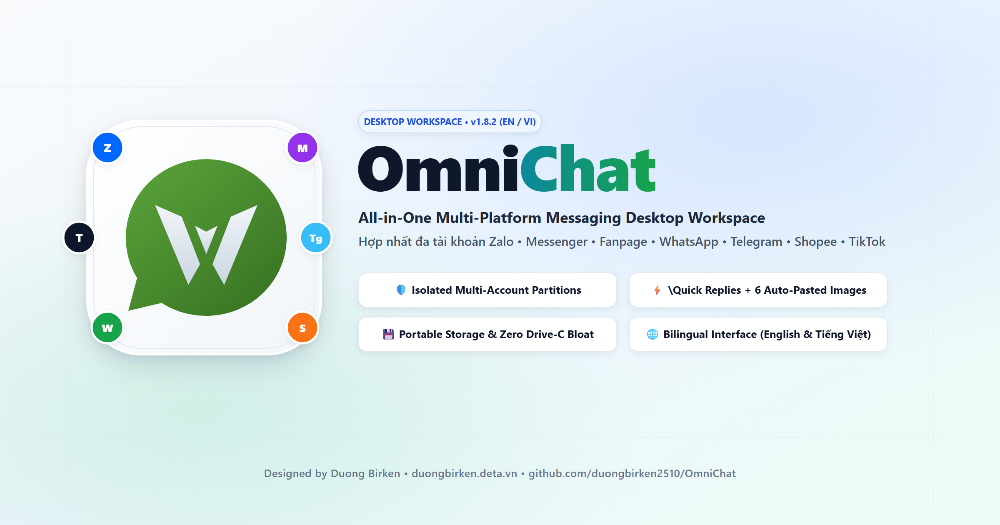
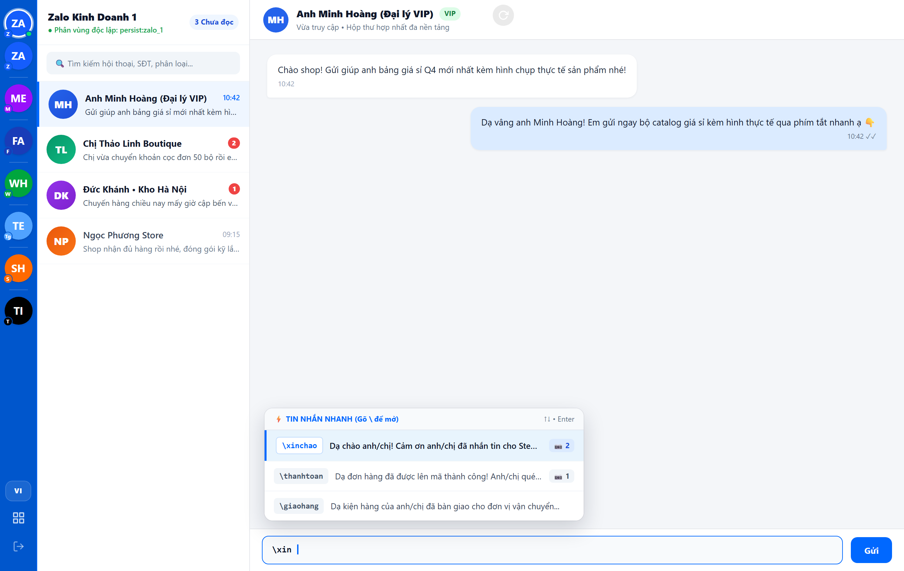
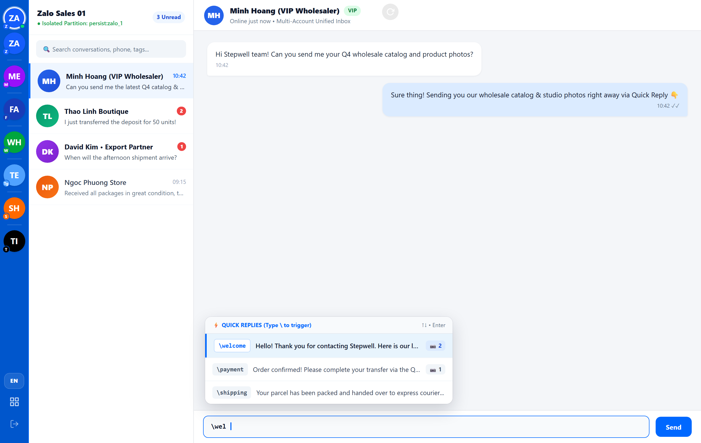
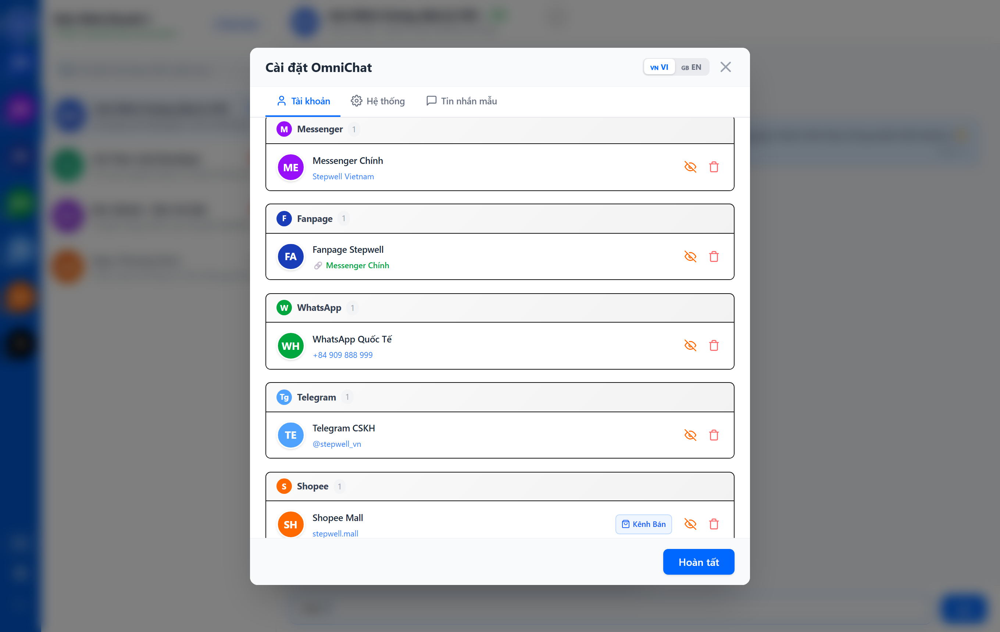
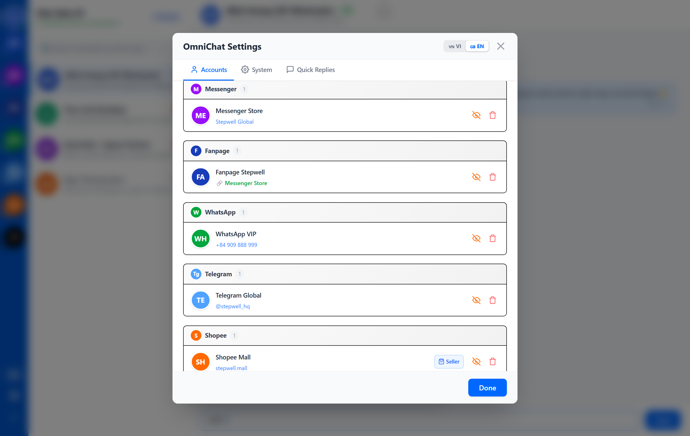
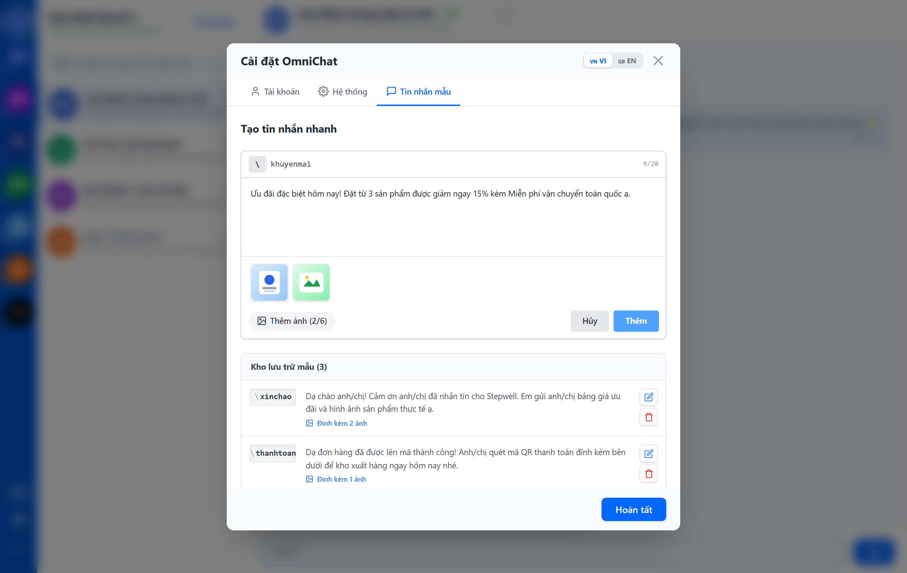
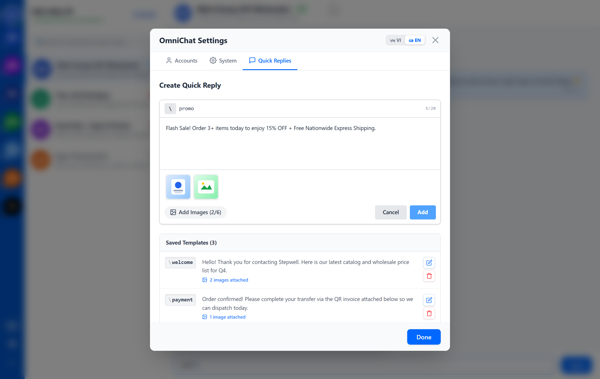
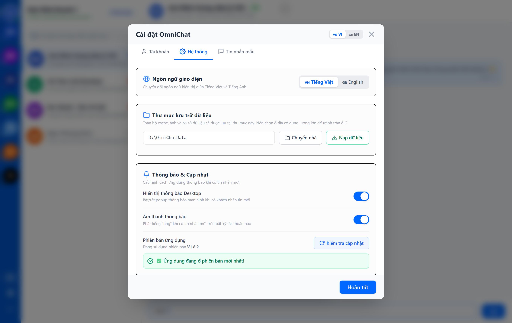
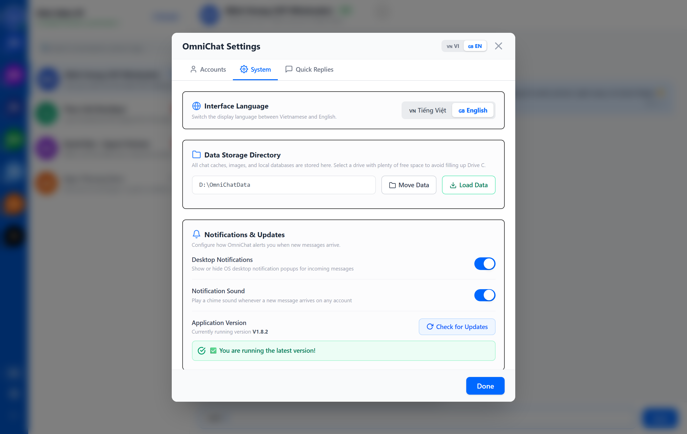

# 💬 HỒ SƠ GIỚI THIỆU SẢN PHẨM & CÔNG NGHỆ: OMNICHAT (v1.8.2)

  

> **Khẩu hiệu (Tagline):** *"Ứng dụng Desktop Chat Đa Kênh & Đa Tài Khoản — Gom 7 nền tảng về 1 cửa sổ, gõ `\` tự dán kịch bản + 6 ảnh, chuyển nhà dữ liệu 0 MB tràn ổ C."*  
> **Nền tảng hỗ trợ:** Windows 10/11 (`.exe`), macOS (`.dmg` / `.zip`), Linux Ubuntu/Debian (`.deb` / `.AppImage`)  
> **Tác giả & Website chính thức:** **Duong Birken** — [https://duongbirken.deta.vn/omnichat](https://duongbirken.deta.vn/omnichat)  
> **Kho mã nguồn & Tải về:** [https://github.com/duongbirken2510/OmniChat](https://github.com/duongbirken2510/OmniChat)

---

## 📑 Mục Lục Nhanh
1. [OmniChat là gì?](#1-omnichat-là-gì)
2. [Các Tính Năng Chính Cung Cấp Cho Người Dùng](#2-các-tính-năng-chính-cung-cấp-cho-người-dùng)
3. [Lợi Ích Mang Lại — Giải Quyết Những "Nỗi Đau" Gì?](#3-lợi-ích-mang-lại--giải-quyết-triệt-để-những-nỗi-đau-gì)
4. [Kịch Bản Thực Tế: Một Ngày Sử Dụng Tiêu Biểu](#4-kịch-bản-thực-tế-một-ngày-sử-dụng-tiêu-biểu)
5. [Kỹ Thuật & Công Nghệ Chuyên Sâu Bên Dưới](#5-kỹ-thuật--công-nghệ-chuyên-sâu-bên-dưới)
6. [Hiệu Quả Công Nghệ & Trải Nghiệm Người Dùng](#6-hiệu-quả-công-nghệ--trải-nghiệm-người-dùng)
7. [Cam Kết Quyền Riêng Tư & Bảo Mật Dữ Liệu](#7-cam-kết-quyền-riêng-tư--bảo-mật-dữ-liệu)
8. [Thư Viện Video Demo & Hình Ảnh Giao Diện](#8-thư-viện-video-demo--hình-ảnh-giao-diện)
9. [Cấu Hình Yêu Cầu & Câu Hỏi Thường Gặp (FAQ)](#9-cấu-hình-yêu-cầu--câu-hỏi-thường-gặp-faq)
10. [Lộ Trình Phát Triển Tiếp Theo & Liên Hệ Tác Giả](#10-lộ-trình-phát-triển-tiếp-theo--liên-hệ-tác-giả)

---

## 1. OmniChat là gì?
- **Định nghĩa sản phẩm:** **Stepwell OmniChat (v1.8.2)** là ứng dụng Desktop mã nguồn mở giúp hợp nhất không giới hạn tài khoản từ **7 nền tảng nhắn tin và thương mại điện tử** phổ biến nhất hiện nay (**Zalo Web, Facebook Messenger, Facebook Fanpage / Meta Business Suite, Shopee Seller Chat, TikTok Shop Seller Chat, Telegram Web K và WhatsApp Web**) vào một cửa sổ làm việc duy nhất.
- **Đối tượng người dùng mục tiêu:**
  - **Đội ngũ Kinh doanh, Telesale & CSKH:** Cần trực đồng thời 5–20 tài khoản Zalo cá nhân và Messenger trên một máy tính mà không bị văng nick.
  - **Chủ shop Thương mại điện tử & Livestream:** Quản lý nhiều gian hàng Shopee, TikTok Shop và Fanpage Facebook cùng lúc, cần kiểm tra đơn hàng và gửi hình ảnh sản phẩm/mã QR tức thì.
  - **Doanh nghiệp B2B & Quốc tế:** Vận hành nhiều số điện thoại WhatsApp và Telegram độc lập, cần giao diện song ngữ Anh – Việt và khả năng mang toàn bộ hồ sơ dữ liệu đi trên USB/ổ cứng rời.
- **Triết lý thiết kế cốt lõi:** *"Kinh doanh thảnh thơi — Không bỏ sót tin nhắn khách, trả lời kèm 6 ảnh trong 1 giây, không làm đầy ổ C và hoàn toàn miễn phí trọn đời (0đ/tháng)."*

---

## 2. Các Tính Năng Chính Cung Cấp Cho Người Dùng

| Nhóm tính năng | Chi tiết trải nghiệm cung cấp cho người dùng |
| :--- | :--- |
| **1. Hợp nhất 7 Nền tảng & Đa Tài Khoản (`×N`)** | • Đăng nhập không giới hạn tài khoản **Zalo, Messenger, Fanpage, Shopee, TikTok Shop, Telegram, WhatsApp**. • Mỗi tài khoản chạy trên phân vùng Chromium `persist:` độc lập, tuyệt đối không đụng cookie hay đăng xuất chéo. |
| **2. Liên kết Fanpage chung Cookie (`Shared-Cookie Linking`)** | • Cho phép gắn một hoặc nhiều tài khoản **Facebook Fanpage (Meta Business Suite)** dùng chung phiên cookie với tài khoản **Messenger** đã đăng nhập sẵn — vào thẳng hộp thư Fanpage mà không cần nhập lại mật khẩu hay mã 2FA. |
| **3. Gõ phím tắt `\` tự dán kịch bản + 6 hình ảnh** | • Gõ dấu `\` trong bất kỳ ô nhập chat nào để bật menu gợi ý tin nhắn mẫu (`\xinchao`, `\baogia`, `\thanhtoan`...). • Tự động điền văn bản trước, sau đó nạp tuần tự tối đa **6 hình ảnh sản phẩm / mã QR** vào Clipboard gốc của hệ điều hành và dán thẳng vào khung chat chỉ trong 1 giây. |
| **4. "Chuyển nhà dữ liệu" (`Move Data`) & Hồ sơ di động (`Load Data`)** | • Di chuyển toàn bộ thư mục dữ liệu `OmniChatData` từ ổ `C:\` sang ổ `D:\`, `E:\` hoặc ổ cứng rời chỉ với 1 cú nhấp chuột, giữ nguyên 100% phiên đăng nhập và mẫu chat. • Nạp trực tiếp hồ sơ dữ liệu có sẵn từ USB khi chuyển sang máy tính mới. |
| **5. Chế độ "Ẩn" tài khoản giải phóng 100% RAM (`0 MB`)** | • Các tab không hiển thị tự động tạm dừng quét DOM/Avatar để tiết kiệm CPU. • Khi bấm nút **Ẩn** trên tài khoản ít dùng, OmniChat tháo hoàn toàn tiến trình `<webview>` khỏi bộ nhớ (`0 MB RAM`) nhưng vẫn bảo toàn cookie đăng nhập trên ổ cứng. |
| **6. Chuông báo thời gian thực & Giao diện Song ngữ `VI / EN`** | • Bắt trực tiếp sự kiện `window.Notification`, phát âm báo nhẹ nhàng qua `Web Audio API`, hiện thông báo góc màn hình và đếm tổng số tin chưa đọc trên Sidebar. • Chuyển đổi tức thì 100% giao diện giữa **Tiếng Việt (`🇻🇳 VI`)** và **Tiếng Anh (`🇬🇧 EN`)** chỉ với 1 cú click. |

---

## 3. Lợi Ích Mang Lại — Giải Quyết Triệt Để Những "Nỗi Đau" Gì?

1. **Giải quyết nỗi đau "Mở 15–20 cửa sổ Chrome / Cốc Cốc rối loạn và sót tin nhắn khách":**
   - *Nỗi đau thực tế:* Nhân viên sale phải mở hàng chục profile trình duyệt khác nhau cho từng nick Zalo, Fanpage, Shopee. Khi khách nhắn tin, không biết thông báo phát ra từ cửa sổ nào dẫn đến phản hồi chậm và mất đơn.
   - *Giải pháp của OmniChat:* Gom toàn bộ về một thanh Sidebar duy nhất có huy hiệu số tin chưa đọc màu đỏ và chuông báo thời gian thực cho từng tài khoản.
2. **Giải quyết nỗi đau "Không thể đăng nhập nhiều nick Zalo cá nhân ổn định trên 1 máy":**
   - *Nỗi đau thực tế:* Ứng dụng Zalo PC chỉ cho phép 1 tài khoản, trong khi mở trên trình duyệt web thường xuyên bị xung đột cookie hoặc mất phiên khi tắt máy.
   - *Giải pháp của OmniChat:* Cấp cho mỗi nick Zalo một phân vùng `persist:zalo_<id>` riêng biệt, tự động đồng bộ tên thật & ảnh đại diện từ Zalo Web và giữ phiên đăng nhập bền vững.
3. **Giải quyết nỗi đau "Đầy cứng ổ C làm máy tính bị đơ và giật lag":**
   - *Nỗi đau thực tế:* Khi trực 10–20 nick Zalo và Telegram, dữ liệu cache ảnh/video phình lên hàng chục GB nằm cố định trong `%APPDATA%` trên ổ C khiến Windows bị treo.
   - *Giải pháp của OmniChat:* Tự động ưu tiên ổ `D:\OmniChatData` ngay khi khởi tạo và cung cấp công cụ **"Chuyển nhà dữ liệu"** (`migrate-storage`) giúp giải phóng hoàn toàn ổ C.

---

## 4. Kịch Bản Thực Tế: Một Ngày Sử Dụng Tiêu Biểu (`A Day in the Life`)

| Thời điểm / Bước | Tình huống thực tế của người dùng | Cách OmniChat phản hồi thông minh |
| :--- | :--- | :--- |
| **08:00 — Mở ca trực** | Nhân viên CSKH bật máy tính, mở OmniChat để trực 5 nick Zalo, 3 Fanpage, 2 shop Shopee và 2 shop TikTok. | Toàn bộ 12 tài khoản tự động khôi phục phiên đăng nhập từ ổ `D:\OmniChatData` mà không cần quét lại mã QR hay nhập lại 2FA. |
| **09:30 — Khách hỏi giá sỉ** | Khách hàng nhắn tin trên Zalo số 3 và Shopee Shop 1 cùng lúc. | Chuông báo `Web Audio` vang lên nhẹ nhàng, huy hiệu số tin chưa đọc nhảy đỏ trên đúng avatar Zalo số 3 và Shopee 1. |
| **09:31 — Chốt đơn trong 1 giây** | Nhân viên cần gửi bảng giá sỉ kèm 6 tấm ảnh chụp thực tế sản phẩm và mã QR ngân hàng. | Nhân viên chỉ cần gõ `\giasi` rồi nhấn `Enter` — OmniChat tự động điền lời chào, bảng giá và dán liên tiếp cả 6 tấm ảnh vào khung chat. |
| **14:00 — Kiểm tra đơn hàng** | Khách trên Shopee hỏi tình trạng vận đơn. | Nhân viên bấm nút chuyển **1-Click (`Kênh Người Bán / Seller Center`)** ngay trên thanh công cụ để tra mã đơn trên cùng phiên đăng nhập Shopee. |
| **17:30 — Tối ưu máy & Sao lưu** | Cuối ngày làm việc, nhân viên ẩn bớt các tài khoản ca tối và cắm USB đồng bộ. | Các tài khoản bấm **Ẩn** giải phóng về `0 MB RAM`; kho tin nhắn mẫu tự động được ghi snapshot an toàn ra file `snippets-backup.json`. |

---

## 5. Kỹ Thuật & Công Nghệ Chuyên Sâu Bên Dưới

1. **Cơ chế Cách ly Phiên Đa Phân Vùng (`Session Partitioning`) & Liên kết Cookie (`src/main/index.ts`):**
   - Mỗi tài khoản khi khởi tạo được gán định danh phân vùng `persist:<platform>_<timestamp>`. Đối với tính năng **Facebook Fanpage dùng chung Cookie**, người dùng có thể trỏ `partition` của Fanpage vào cùng chuỗi `persist:` của tài khoản Messenger đã xác thực, giúp chia sẻ `Cookies` và `Local Storage` hợp lệ của Meta mà không cần đăng nhập lại.
2. **Kiến trúc "Chuyển Nhà Dữ Liệu" & Sao Chép Phiên Tinh Gọn (`copySessionForPartition` trong `src/main/index.ts`):**
   - Thay vì copy toàn bộ hàng chục ngàn file cache rác (`Cache/`, `Code Cache/`, `GPUCache/`) gây treo máy hoặc lỗi khóa file (`EBUSY`), hàm `copySessionForPartition(srcPartition, destPartition)` chỉ trích xuất chính xác 5 file trạng thái xác thực (`Cookies`, `Cookies-journal`, `Preferences`, `Network Persistent State`, `TransportSecurity`) và 2 thư mục (`Local Storage`, `Session Storage`), đồng thời sao lưu kho ảnh tin nhắn mẫu `snippet_images/` và `snippets-backup.json`. Nhờ đó quá trình "Chuyển nhà" sang ổ `D:\` diễn ra trong vài giây và giảm 80–90% dung lượng rác.
3. **Engine Gõ Tắt `\` & Tự Động Dán 6 Ảnh Qua Native Clipboard (`src/preload/webview.ts` & `src/main/index.ts`):**
   - Trong `src/preload/webview.ts`, bộ lắng nghe sự kiện bàn phím (`keydown` ở giai đoạn `capture: true`) phát hiện ký tự `\`, mở popup `#omnichat-snippet-overlay` định vị thông minh theo tọa độ `getBoundingClientRect()` của ô nhập chat.
   - Khi người dùng chọn mẫu (`selectSnippet`), hàm `insertSnippetContent` xóa chuỗi `\phimtat` vừa gõ, chèn văn bản qua `document.execCommand('insertText')`, sau đó gửi IPC `prepare-clipboard-image` về Main Process để nạp từng file ảnh qua `nativeImage.createFromPath(imgPath)` vào `clipboard.writeImage(image)` và kích hoạt `webContents.paste()` tuần tự cho tới đủ 6 ảnh.
4. **Bộ Chặn Giao Thức Lạ 3 Lớp (`Triple-Layer Custom Protocol Shield` trong `src/main/index.ts`):**
   - Để ngăn TikTok Shop và Shopee tự ý bật popup đòi mở ứng dụng ngoài (`bytedance://`, `tiktok://`), OmniChat kết hợp 3 lớp bảo vệ: (1) `contents.on('will-navigate')`, (2) `session.webRequest.onBeforeRequest` hủy từ tầng mạng (`cancel: true`), và (3) `protocol.handle('bytedance', () => new Response(null, { status: 204 }))` nuốt hoàn toàn request từ iframe.
5. **Tối Ưu Hóa CPU/RAM Theo Trạng Thái Hiển Thị (`Visibility-Aware Polling` trong `src/preload/webview.ts`):**
   - Biến cờ `window.__omnichat_visible` được cập nhật động từ `App.vue` mỗi khi người dùng chuyển tab. Khi tab ở trạng thái ẩn (`__omnichat_visible === false`), toàn bộ bộ quét DOM (`scanDomForUnread`), bộ đồng bộ Avatar (`scrapeAccountInfo`) và bộ nạp Snippet tự động tạm nghỉ (`0% CPU`), chỉ giữ lại `window.Notification` Interceptor và `MutationObserver` trên thẻ `<title>`.

---

## 6. Hiệu Quả Công Nghệ & Trải Nghiệm Người Dùng

| Tiêu chí đánh giá | Mở 15–20 Cửa Sổ Trình Duyệt (Chrome / Cốc Cốc) | Hiệu quả thực tế trên **Stepwell OmniChat v1.8.2** |
| :--- | :--- | :--- |
| **Quản lý hội thoại** | Rải rác hàng chục cửa sổ, dễ bỏ sót tin nhắn khách | **Hợp nhất 7 kênh trên 1 Sidebar**, báo chuông & đếm tin chưa đọc tức thì |
| **Gửi kịch bản + 6 ảnh sản phẩm** | Phải copy chữ rồi chọn đính kèm từng ảnh (mất 25–30 giây) | **Gõ `\phimtat` + Enter (chỉ mất 1 giây)** tự điền chữ và dán đủ 6 ảnh |
| **Mức tiêu thụ RAM** | 4 GB – 10 GB RAM (luôn giữ toàn bộ tiến trình nền) | **Tiết kiệm 60–75% RAM**; tài khoản bấm **Ẩn** tiêu thụ **`0 MB RAM`** |
| **Dung lượng ổ hệ thống (Ổ C)** | Phình to 10–30 GB trong `%LOCALAPPDATA%`, gây đơ máy | **`0 MB` trên ổ C** nhờ tính năng "Chuyển nhà dữ liệu" sang ổ `D:\` / USB |
| **Chi phí bản quyền** | Phần mềm SaaS thu phí 500.000đ – 1.200.000đ / tháng | **Miễn phí 100% trọn đời (`0đ/tháng`)** · Mã nguồn mở · Không quảng cáo |

---

## 7. Cam Kết Quyền Riêng Tư & Bảo Mật Dữ Liệu
- **Lưu trữ cục bộ 100% (`100% Local-First Privacy`):** Toàn bộ cookie phiên đăng nhập, lịch sử hội thoại, danh sách tài khoản và kho tin nhắn mẫu đều được lưu trữ trực tiếp trên ổ cứng máy tính của người dùng (`IndexedDB` + `OmniChatData`).
- **Không qua máy chủ trung gian (`Zero Middleman Server`):** OmniChat kết nối trực tiếp từ máy tính của bạn tới máy chủ chính thức của Zalo, Meta, Shopee, TikTok, Telegram và WhatsApp — tuyệt đối không thu thập mật khẩu, không đọc trộm tin nhắn và không chèn bất kỳ mã theo dõi quảng cáo nào.

---

## 8. Thư Viện Video Demo & Hình Ảnh Giao Diện

### 🖼️ 1. Giao diện Hộp thư Hợp nhất & Gõ tắt `\` (Tiếng Việt & Tiếng Anh)

### 🖼️ 2. Quản lý Đa Tài Khoản & Liên kết Fanpage Chung Cookie

### 🖼️ 3. Kho Tin Nhắn Mẫu Kèm Tự Động Dán 6 Hình Ảnh

### 🖼️ 4. Cài Đặt Hệ Thống: Song Ngữ 1-Chạm & Chuyển Nhà Dữ Liệu

---

## 9. Cấu Hình Yêu Cầu & Câu Hỏi Thường Gặp (FAQ)

### 💻 Cấu Hình Yêu Cầu & Bộ Cài Chính Thức v1.8.2
- **Windows:** Windows 10 / 11 (64-bit) — [`OmniChat_V1.8.2_Setup.exe` (78.9 MB)](https://github.com/duongbirken2510/OmniChat/releases/download/v1.8.2/OmniChat_V1.8.2_Setup.exe)
- **macOS:** macOS 12+ (Intel & Apple Silicon) — [`OmniChat_V1.8.2.dmg` (242 MB)](https://github.com/duongbirken2510/OmniChat/releases/download/v1.8.2/OmniChat_V1.8.2.dmg) hoặc [`OmniChat_V1.8.2_macOS.zip` (95 MB)](https://github.com/duongbirken2510/OmniChat/releases/download/v1.8.2/OmniChat_V1.8.2_macOS.zip)
- **Linux:** Ubuntu 20.04+, Debian, Mint, Fedora (64-bit) — [`OmniChat_V1.8.2_amd64.deb` (81 MB)](https://github.com/duongbirken2510/OmniChat/releases/download/v1.8.2/OmniChat_V1.8.2_amd64.deb) hoặc [`OmniChat_V1.8.2.AppImage` (80 MB)](https://github.com/duongbirken2510/OmniChat/releases/download/v1.8.2/OmniChat_V1.8.2.AppImage)
- **Phần cứng khuyến nghị:** CPU Core i3 / Apple M1 trở lên, RAM từ 4 GB (khuyến nghị 8 GB nếu mở trên 10 tài khoản đồng thời).

### ❓ Câu Hỏi Thường Gặp (FAQ)
1. **Khi mở lần đầu trên Windows hoặc macOS hiện cảnh báo chưa xác minh thì làm sao?**
   - **Trên Windows:** Khi hiện bảng SmartScreen, bấm **More info** ➔ chọn **Run anyway**.
   - **Trên macOS:** Kéo ứng dụng vào thư mục `Applications`, sau đó mở Terminal chạy lệnh: `xattr -cr "/Applications/Stepwell OmniChat.app"`.
2. **Cập nhật phiên bản OmniChat mới có bị mất tài khoản đã đăng nhập và tin nhắn mẫu không?**
   - **Không.** Toàn bộ phiên đăng nhập được giữ trong thư mục `OmniChatData` và kho tin nhắn mẫu được sao lưu kép ra file `snippets-backup.json` để tự động khôi phục 100%.

---

## 10. Lộ Trình Phát Triển Tiếp Theo & Liên Hệ Tác Giả

### 🚀 Lộ Trình Các Phiên Bản Tiếp Theo (`Roadmap`)
- **v1.9:** Hỗ trợ gán Proxy riêng biệt (`HTTP / SOCKS5`) cho từng phân vùng tài khoản Zalo / Facebook / Shopee để phục vụ đội ngũ vận hành số lượng lớn tài khoản trên cùng một đường truyền mạng.
- **v2.0:** Tích hợp Trợ lý AI gợi ý câu trả lời thông minh theo ngữ cảnh hội thoại và phân loại thẻ trạng thái khách hàng (`VIP`, `Chờ chuyển khoản`, `Đã chốt đơn`) ngay trên Sidebar.

### 👨‍💻 Tác Giả & Liên Hệ / Author & Contact

| 🇻🇳 Lời nhắn từ Tác giả | 🇬🇧 Note from the Author |
| :--- | :--- |
| **OmniChat** là dự án tâm huyết được phát triển bởi **Duong Birken** từ thực tế vận hành đội ngũ CSKH đa kênh tại Stepwell Vietnam. Nếu dự án hữu ích với bạn, hãy tặng một ngôi sao (**⭐ Star**) trên GitHub hoặc ghé thăm website chính thức để kết nối và góp ý thêm nhé! | **OmniChat** is crafted with passion by **Duong Birken** from real-world multi-channel e-commerce operations at Stepwell Vietnam. If you find this project helpful, please consider giving it a **⭐ Star** on GitHub or visiting the official website to connect and share your feedback! |

- **🌐 Website chính thức & Trang sản phẩm:** [**https://duongbirken.deta.vn/omnichat**](https://duongbirken.deta.vn/omnichat)
- **📖 Cẩm nang Hướng dẫn sử dụng A–Z:** [**docs/USER_GUIDE.md**](../docs/USER_GUIDE.md)
- **📦 Kho mã nguồn & Tải bộ cài đặt:** [**https://github.com/duongbirken2510/OmniChat**](https://github.com/duongbirken2510/OmniChat)
